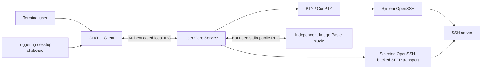

# Design: architecture and feasibility documentation

## Status and boundary

Approved by the user on 2026-10-22 after review of the planning summary and language/architecture explanation. This task produces the source XIII design package, not an application or completed feasibility experiments. The existing [contracts](../../spec/trellis-plus/sshx-contracts.md) remain the shared requirements summary; the verbatim source remains unchanged.

The package is one integrated deliverable because its protocol, state machines, failure transaction and experiment gates must agree before Phase 0 can begin. Do not create a task per document or create follow-up product tasks automatically.

## Artifact ownership

The source already proposes `docs/` for architecture, ADRs and protocols. Create only the concrete documents below during execution; no README, empty code tree or parallel specification framework.

| Artifact | Responsibility | PRD coverage |
| --- | --- | --- |
| `docs/architecture.md` | Entry to the design package; classified requirements/traceability, process and dependency diagrams, CLI invocation table, Core lifecycle and per-session context | R1, R3 |
| `docs/platform-matrix.md` | Capability and environment matrix, prerequisites, fallback and evidence status; distinguish planned coverage from runtime support | R2 |
| `docs/protocol.md` | Seven models/state machines, Client IPC roles, plugin lifecycle/manifest and public protocol, bounded resources, authorization/errors/events/cancellation | R4 |
| `docs/image-paste.md` | Successful sequence, upload/insert separation, failure/race table, path/format context and ownership/cleanup | R5 |
| `docs/adr/0001-language.md` through `0006-remote-integration.md` | Six short decisions with status/evidence and explicit Phase 0 selection gates where applicable | R6 |
| `docs/phase-0.md` | Experiment runbook, fixture boundaries, source XII coverage and staged follow-up/entry and exit gates | R7 |
| Task `research/` and `check-report.md` | Dated primary-source evidence and actual document validation; no runtime claims | AC8 |

Do not register future output documents as existing JSONL inputs. The role contexts contain actual policies/source/research, while workers read planning artifacts and output files directly. Main session owns task metadata, manifests, lifecycle and mainline.

## Architecture baseline to elaborate

- Client owns terminal/desktop interaction; Core owns children, PTYs, single-writer Attachments, transport resources and effect checks. No concrete-plugin dependency in Core.
- Control messages, terminal bytes and file/blob payloads require separate bounded paths. A slow plugin must not stall terminal I/O.
- Bind work at creation to plugin instance, operation, Session/generation, initiating Client/Attachment, target/config generation and grants. Define the exact effect-time validation and cancellation linearization in the protocol document.
- Distinguish process, authentication and trustworthy Shell readiness; absent evidence remains unknown. Distinguish detach survival, screen/mode restoration and remote recovery.
- SFTP and Shell paths are separate namespaces. Transfer completion never establishes safe insertion context. Preserve a successfully uploaded result when insertion is refused or stale.
- Local Client and plugin channels are distinct roles. Authenticate IPC peers; derive plugin identity from its process/channel; an unsandboxed trusted plugin still has same-user filesystem/network authority outside RPC.

This baseline repeats only the load-bearing ownership decisions needed to guide document production; the final protocol defines exact fields, limits and errors once rather than duplicating competing schemas across files.

## Protocol and decision design method

For every model, specify fields and their types/unknown representation, owner, state transitions, identifiers, retention and cleanup. For each RPC/action, specify direction, request/result, permission scope, effect-time checks, quotas, idempotency, cancellation and errors. Define Content-Length byte framing, header/body bounds, UTF-8/JSON rejection, version negotiation and request/event ordering without assuming JSON-RPC defines transport or authorization.

Use one normative home for each numeric limit and error taxonomy in `docs/protocol.md`; other documents link to it. Validate examples against those definitions. Distinguish API-version compatibility from Core/plugin package versioning and refuse incompatible roles/versions before serving privileged methods.

Bounded blob handles must not become arbitrary local file paths. Include composed-capability, expiry, revocation and in-flight disable behavior. Document image dimension/decoded-memory/encoded-size limits and overflow/backpressure policies as proposed design constants, not measured safe defaults.

ADRs retain Rust plus system OpenSSH as the source default. Compare the two source-defined SFTP routes and bounded VT versus restricted redraw by feasibility criteria; do not build both backends or select a winner from documentation alone. Defer exact crate selection/version pins until executed evidence exists. Cite only primary sources for current external technical claims; note verification date and what remains untested.

## Phase 0 execution boundary

The runbook defines reproducible experiments without running them. A command needing a future harness is labeled as such and accompanied by that harness's required input/output contract; it cannot be reported as a runnable current-repository test. Use standard-tool procedures where possible. Every experiment records environment dimensions, controlled fixtures/identities, commands, result, limitation and alternative.

Before Phase 0 execution, a separate task must select the primary native environment, establish toolchain/fixture availability and obtain any installation/remote/container authority actually needed. Windows/macOS/Linux desktop gaps remain explicit matrix entries. The current host does not select product platform priority implicitly.

## Compatibility and rollback

There is no existing product API or release to migrate. Proposed v1 schemas can be changed consistently across all documents before publication; do not add speculative legacy aliases. Preserve the source's future independent-plugin/public-API commitment.

The task changes documentation plus task/mainline project data only. Rollback is an explicit patch to task-owned documents and mainline, preserving unrelated edits and retained source/runtime files. No live sessions, credentials, services or remote files are touched. New technical evidence that changes fixed product behavior returns to planning and user review; resolving a documented technical unknown within the approved requirements does not itself expand scope.
